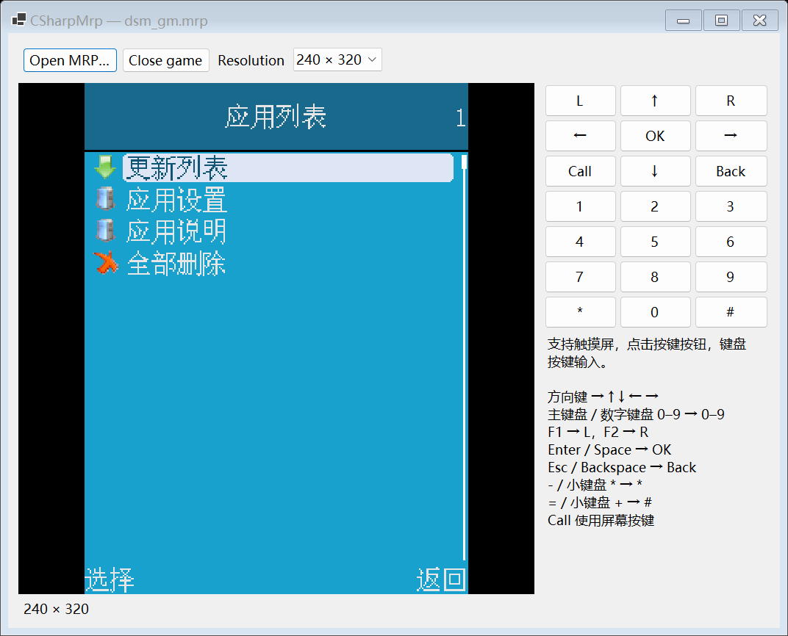

# CSharpMrp

CSharpMrp 是一款用 C# 编写的 MRP 模拟器，用于在现代设备上运行功能机时代的 `.mrp` 游戏和应用。项目参考了 vmrp，并借助 OpenAI Codex 开发。模拟器内置 C# ARM 解释器，直接执行 MRP 程序中的 ARM 指令，无需依赖 Unicorn。 [vmrp/vmrp](https://github.com/vmrp/vmrp) · [OpenAI Codex](https://openai.com/codex/)

## 运行方式

| 入口 | 平台与用途 |
| --- | --- |
| [Desktop](Desktop/) | Windows x64 的 Windows Forms 独立播放器，可直接在 Windows 上运行。 |
| [UnityMrp](UnityMrp/) | Unity 播放器示例与集成入口，面向 Android、iOS、Windows、macOS 和 WebGL。 |

两个播放器都支持打开本地 MRP、使用键盘或屏幕按键、在游戏画面上触摸或拖动，以及在运行中切换分辨率。模拟核心提供音频播放和存档支持。不同 MRP 使用的系统功能可能不同，兼容性因程序和平台而异。

## 快速开始

`mythroad/` 只附带模拟运行所用的系统资源、启动入口和兼容插件。想运行的 MRP 游戏或应用请自行从网上寻找并获取有权使用的文件。

### Windows Forms

安装 .NET 10 SDK，在仓库根目录运行以下命令。 [.NET 10 SDK 下载](https://dotnet.microsoft.com/en-us/download/dotnet/10.0)

```powershell
dotnet run --project Desktop/CSharpMrp.Desktop.csproj
```

启动后点击 **Open MRP** 选择 `.mrp` 文件。需要生成 Windows x64 自包含发布包时，可运行 [`Desktop/build-release.bat`](Desktop/build-release.bat)。



### Unity

使用团结引擎 1.10.2（2022.3.62t14）打开 `UnityMrp/`，加载 [`Assets/Player.unity`](UnityMrp/Assets/Player.unity) 并进入 Play Mode。在 Game 视图点击 **Open MRP**，输入本地文件路径。

### WebGL

安装 WebGL 构建模块，在 Unity 的 **Build Settings** 中选择 **WebGL**，将 `Assets/Player.unity` 加入场景列表后点击 **Build And Run**。构建会自动打包 Mythroad 运行资源，浏览器中点击 **Open MRP** 即可选择本地 `.mrp` 文件。点击 **Close game** 后会同步存档到当前站点的浏览器存储。刷新页面后可重新选择同一个文件继续读档。

静态部署时通过 HTTP(S) 提供构建目录，并按所选压缩格式配置服务器响应。部署到其他平台时，安装对应的 Unity 构建模块，并接入适合该平台的资源读取和存档目录。

## 项目结构

| 目录 | 内容 |
| --- | --- |
| [`Core/`](Core/) | 共享的 C# 模拟核心，包括 ARM 解释器、MRP 运行环境和宿主接口。 |
| [`Desktop/`](Desktop/) | Windows Forms 播放器。 |
| [`UnityMrp/`](UnityMrp/) | Unity 示例工程和 `com.mrp.csharp.unity` 适配包。 |
| [`mythroad/`](mythroad/) | 模拟运行所用的系统资源、启动入口和兼容插件。 |
| [`Tools/`](Tools/) | 本地验证和兼容性检查工具。 |

## 致谢与第三方项目

感谢 vmrp 的作者和贡献者公开源码，为理解 MRP 运行环境和实现 C# 模拟器提供了参考。 [vmrp/vmrp](https://github.com/vmrp/vmrp)

| 项目 | 用途 |
| --- | --- |
| [Windows Forms](https://github.com/dotnet/winforms) | Windows 桌面播放器界面。 |
| [Unity UI（uGUI）](https://github.com/Unity-Technologies/uGUI) | Unity 播放器界面和触摸输入。 |
| [NAudio](https://github.com/naudio/NAudio) | Windows 音频输出，使用 [NAudio.Wasapi](https://www.nuget.org/packages/NAudio.Wasapi/2.2.1)。 |
| [NLayer](https://github.com/naudio/NLayer) | MP3 解码。[随附许可证](Core/Runtime/Plugins/NLayer-LICENSE.txt) |
| [CSharpSynth](https://github.com/sinshu/CSharpSynthProject) | Alex Veltsistas 编写的 MIDI 合成库，链接指向原 CodePlex 项目的存档。项目同时使用其 [GM 音色库](https://github.com/sinshu/CSharpSynthProject/tree/master/RES/Patches/GMBank)。[随附许可证](Core/Runtime/ThirdParty/CSharpSynth/LICENSE.txt) |
| [Mono I18N](https://github.com/Unity-Technologies/mono/tree/unity-main/mcs/class/I18N) | WebGL 的旧版中文编码支持。[随附许可证](UnityMrp/Assets/Plugins/WebGL/LICENSE-Mono.txt) |
| [Resource Han Rounded](https://github.com/CyanoHao/Resource-Han-Rounded) | WebGL 界面使用的中文字体。[随附许可证](UnityMrp/Assets/Resources/ResourceHanRounded-OFL.txt) |

## 许可证

CSharpMrp 源码采用 GNU General Public License v3.0。随附第三方组件适用各自的许可条款。[项目许可证](LICENSE)

## 问题反馈

遇到兼容性问题，欢迎提交 Issue。请附上使用的播放器、系统版本、MRP 文件名、复现步骤，以及可用的错误日志或截图。
